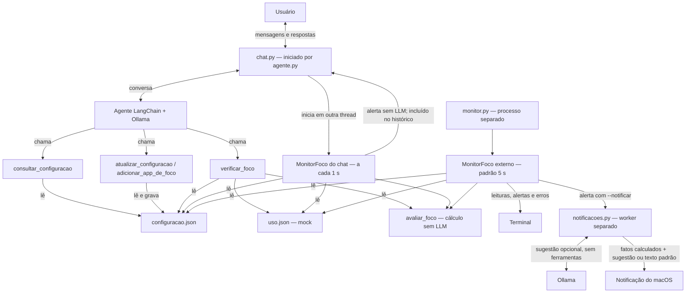

# Agente de foco

Agente local que acompanha um plano de foco salvo em JSON. Há dois programas:

- `python agente.py` abre o chat com Ollama, permite alterar a configuração e monitora os arquivos para enviar avisos espontâneos.
- `python monitor.py` relê os arquivos e avisa no terminal quando o uso fora do foco passa do limite. Funciona sem chat e sem Ollama.

Os minutos em `uso.json` são mockados e pertencem ao período informado no próprio arquivo. A sessão planejada tem início e fim em `configuracao.json`. Este projeto não coleta o uso real do celular.

## Fluxo

O comando `python agente.py` abre a interface em `chat.py`. O agente LangChain
interpreta as mensagens com o Ollama e executa ferramentas para consultar o foco
ou alterar a configuração. As ferramentas `atualizar_configuracao` e
`adicionar_app_de_foco` gravam `configuracao.json`; nenhuma grava `uso.json`.

O cálculo é compartilhado: `avaliar_foco` soma os minutos dos apps fora das
exceções e considera excesso quando a soma é **maior** que o limite. Igualar o
limite ainda não gera alerta. O modelo não decide essa comparação.



As setas mostram chamadas, leituras e entregas; os retornos das ferramentas ao
agente foram omitidos para simplificar. O chat mantém a conversa apenas em memória.
Cada monitor tem seu próprio controle de alertas: os dois processos compartilham
os JSON, mas não o histórico nem o estado de entrega. O aviso no chat usa texto
fixo; somente a sugestão da notificação nativa pode ser escrita pelo modelo.

## Requisitos

- Python 3.11 ou superior
- [Ollama](https://ollama.com) em execução, para o chat e para sugestões nas notificações (opcionais)
- O modelo `qwen2.5:3b` para as funcionalidades que usam Ollama
- macOS para notificações nativas; chat e saída no terminal também podem ser usados no Windows/Linux

Não é necessária chave de API. O monitor no terminal e a notificação com
`--sem-ia` não precisam do serviço Ollama em execução.

## Instalação

Na pasta `simples_langchain`, para criar um ambiente novo:

```bash
python3 -m venv .venv
source .venv/bin/activate
pip install "langchain>=1.0,<2" "langchain-ollama>=1.0,<2" "pydantic>=2.7,<3" "pytest>=8,<10" "prompt-toolkit>=3.0,<4"
ollama pull qwen2.5:3b
```

No Windows (PowerShell), crie o ambiente com `python -m venv .venv` e ative
com `.venv\Scripts\Activate.ps1`.

Se já usa o ambiente da pasta pai `langchain/.venv`, pode reutilizá-lo com
`source ../.venv/bin/activate` no macOS/Linux, sem criar outro. Os comandos
seguintes pressupõem um ambiente ativado e a pasta `simples_langchain` como
pasta de trabalho. A lista de instalação acima é a deste protótipo; o
`requirements.txt` da pasta pai não contém essas dependências.

Deixe o Ollama aberto antes de iniciar o chat. O agente usa `http://127.0.0.1:11434`.

## Arquivos de configuração e períodos

Os exemplos abaixo são ilustrativos; os arquivos locais podem conter valores
diferentes após os testes no chat.

`configuracao.json` guarda o plano:

```json
{
  "objetivo": "Estudar Python",
  "inicio": "2026-10-29T14:00:00-03:00",
  "fim": "2026-10-29T15:00:00-03:00",
  "limite_distracao": 10,
  "apps_de_foco": ["Docs"]
}
```

`uso.json` representa o intervalo medido e os totais acumulados da coleta mockada:

```json
{
  "inicio": "2026-10-29T14:00:00-03:00",
  "atualizado_em": "2026-10-29T14:35:00-03:00",
  "minutos_por_app": {"Docs": 20, "Instagram": 12}
}
```

A duração da sessão é calculada por `fim - inicio`; não existe mais teto fixo de 60
minutos. A tolerância deve ser não negativa e caber na sessão. Cada total por app
precisa ser finito, não negativo e não superar o tempo medido entre `inicio` e
`atualizado_em`. Por exemplo, 120 minutos no Docs são possíveis numa coleta de
pelo menos 120 minutos de uma sessão que comporte essa coleta.

Todos os horários exigem data e fuso. O início da coleta deve representar o mesmo
instante do início da sessão; `atualizado_em` deve estar entre início e fim, inclusive.
Uma coleta de outro período gera erro: totais por app não permitem recortar quanto
foi usado dentro ou fora de uma janela. Ao mudar a janela, ajuste também a coleta.

Com os arquivos acima: são 35 minutos medidos, 12 minutos fora do foco e 2 minutos
acima da tolerância de 10. O monitor preserva o formato conciso/colorido existente.
No formato verboso e na ferramenta, o resultado também identifica o período e o excesso.

**O relógio da avaliação é `atualizado_em`.** Este protótipo pode reproduzir um
snapshot histórico, mesmo depois do horário planejado; não verifica se a sessão
está ativa no relógio do computador e não inicia/encerra automaticamente por horário.
`horario` no log é quando o arquivo foi lido; `atualizado_em` é até quando houve medição.
Para avançar a simulação, atualize esse horário e os totais juntos.

Os programas leem os JSON na mesma pasta dos scripts. Para usar outros arquivos:

```bash
python monitor.py --configuracao CAMINHO --uso CAMINHO
```

## Conversar com o agente

Com o ambiente ativado e o Ollama aberto:

```bash
python agente.py
```

O chat também monitora os JSON a cada segundo. Se o limite for ultrapassado,
ele mostra uma mensagem automaticamente, mesmo enquanto você digita ou aguarda
o modelo. O texto digitado é preservado. Esse aviso é montado com os valores
calculados, sem chamada extra ao Ollama, e entra no histórico da conversa:
você pode responder “me ajuda a retomar”. A regra é uma mensagem por episódio
de excesso, inclusive se abrir o chat já acima do limite.

Não precisa rodar `monitor.py` para receber avisos no chat. Para receber também
notificações do Mac, mantenha o monitor separado com `--notificar`; cada processo
acompanha os mesmos arquivos de forma independente. Fechar o chat encerra apenas
seu próprio monitoramento. Os avisos seguem o snapshot `atualizado_em`, não o
relógio real da sessão.

Digite `/sair` para encerrar. A conversa existe só enquanto o programa está aberto. O que for alterado permanece em `configuracao.json`.

Exemplos do que dizer:

- `Mude meu limite para 30 minutos`
- `Como está meu foco?`
- `Adicione YouTube aos apps de foco.`
- `Adicione YouTube aos apps permitidos.`

A ferramenta `adicionar_app_de_foco` acrescenta o nome à lista salva sem remover
os apps existentes nem duplicar o mesmo nome. A comparação ignora maiúsculas,
minúsculas e espaços nas extremidades: `youtube` e `YouTube` são o mesmo app,
tanto nas exceções quanto no cálculo do uso. A grafia da primeira ocorrência
é preservada para exibição. Esses apps ficam fora da soma
de distração. `atualizar_configuracao` continua permitindo substituir a lista
inteira quando isso for solicitado.

Se não houver resposta, confira se o Ollama está aberto e se `qwen2.5:3b` foi baixado.

## Acompanhar sem chat

```bash
python monitor.py
```

A cada 5 segundos o monitor imprime uma linha. O formato padrão, `verboso`, é um JSON com `"tipo": "leitura"`. Para observar mais rápido:

```bash
python monitor.py --intervalo 1
```

`--formato conciso` resume cada leitura a `{ horário | ultrapassou: false }` ou `{ horário | ultrapassou: true }`. `false` sai em branco sobre verde e `true` em branco sobre vermelho. Em arquivo, ou com `NO_COLOR`, a linha sai sem cor. JSON inválido aparece como `erro`, em branco sobre âmbar.

`Ctrl+C` encerra. O monitor só lê os arquivos. Usando os dois JSON de exemplo deste README, o uso já ultrapassa o limite (Instagram 12, limite 10). Para testar uma transição nesse cenário, reduza Instagram para 8 em `minutos_por_app`, espere uma leitura e depois volte para 12. A leitura seguinte imprime `"tipo": "alerta"` no formato verboso. No conciso, essa passagem aparece como `true` a cada leitura, enquanto o uso seguir acima do limite.

O alerta sai quando os minutos fora dos apps de foco passam do limite, inclusive se o monitor já abrir nessa situação. Enquanto o uso continuar acima, o aviso não se repete na mesma execução. Reiniciar o processo reinicia esse controle e pode gerar um novo aviso. Depois que o uso volta ao limite ou abaixo, uma nova ultrapassagem gera outro alerta. Uma nova sessão (início/fim diferentes, com coleta compatível) também rearma o alerta. JSON ausente ou inválido gera `"tipo": "erro_leitura"` e a tentativa seguinte acontece no próximo ciclo.

Para guardar a saída:

```bash
python monitor.py > monitor.log
```

## Notificações autônomas no Mac

Com o ambiente Python ativado:

```bash
python monitor.py --intervalo 1 --notificar
```

`--notificar` está disponível apenas no macOS; no Windows/Linux, o programa
informa essa restrição e encerra.

Não precisa abrir o chat. Mantenha o monitor em execução: ele relê os JSON e,
ao detectar excesso, solicita uma notificação do macOS. Sem `--notificar`,
a saída continua somente no terminal.

Objetivo, minutos e limite vêm do cálculo. O Ollama escreve apenas uma sugestão
curta de retomada. Isso acontece em uma thread separada, sem parar as leituras.
Se o modelo falhar, usamos uma mensagem padrão. Para dispensar o Ollama:

```bash
python monitor.py --intervalo 1 --notificar --sem-ia
```

O aviso segue a regra de uma entrega por episódio de excesso descrita acima.
Se a configuração mudar ou o excesso deixar de existir durante a geração,
o aviso pendente é descartado. Falhas de entrega aparecem no terminal, sem
repetição automática naquele episódio. `Ctrl+C` encerra o monitoramento.

O evento `notificacao_solicitada` registra o pedido ao sistema; a apresentação
depende das permissões de notificação e do modo Foco do macOS. Banners podem
sumir automaticamente e continuar na Central de Notificações. Para manter o
aviso na tela, escolha o estilo persistente/Alertas para o aplicativo emissor
em Ajustes do Sistema > Notificações (o nome varia conforme a versão).
Veja o [guia da Apple](https://support.apple.com/pt-br/guide/mac-help/mchle7f8a9b0/mac).

Este protótipo não abre uma conversa ao clicar na notificação. A avaliação
continua baseada no snapshot `atualizado_em`, inclusive para dados históricos.
Numa integração Android futura, a função de entrega será substituída pela
notificação do dispositivo, mantendo a avaliação separada.

## Testes

Na mesma pasta, com o ambiente ativado:

```bash
python -m pytest tests -q
```

## Arquivos

- `agente.py`: ferramentas, validação e avaliação do foco; entrada do programa
- `chat.py`: conversa e avisos autônomos no terminal
- `monitor.py`: leitura periódica e disparo de alertas
- `notificacoes.py`: sugestão opcional do modelo e entrega nativa no macOS
- `configuracao.json`: objetivo, início/fim da sessão, limite e apps de foco
- `uso.json`: início da coleta, instante de atualização e minutos acumulados por app
- `tests/`: testes de configuração, períodos, cálculo, chat, monitor e notificações
