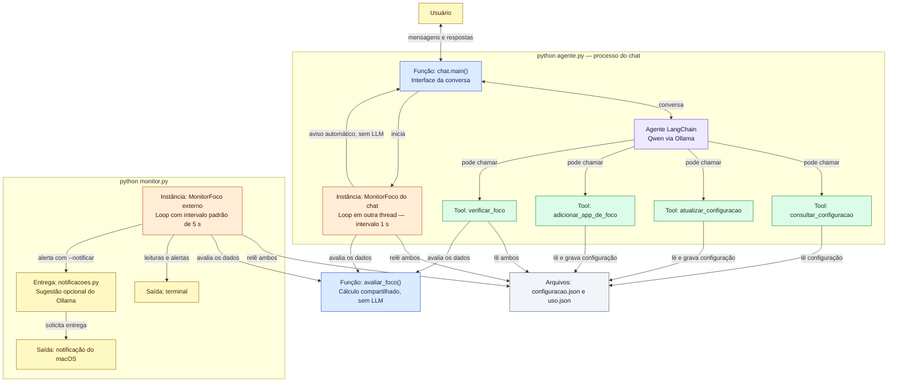

# Agente de foco

Protótipo local com LangChain e Ollama para configurar um objetivo de foco, acompanhar o uso de apps e avisar quando a distração ultrapassa o limite. Os dados de uso são mockados em JSON; ainda não há coleta do celular. Não precisa de chave de API.

## Setup

Requisitos: Python 3.11 ou superior e [Ollama](https://ollama.com). Na pasta `simples_langchain`, crie e ative um ambiente:

```bash
python3 -m venv .venv
source .venv/bin/activate
```

No Windows (PowerShell), use `python -m venv .venv` e `.venv\Scripts\Activate.ps1`. Se já usa o ambiente da pasta pai, basta ativá-lo com `source ../.venv/bin/activate` no macOS/Linux.

Instale as dependências e baixe o modelo:

```bash
pip install "langchain>=1.0,<2" "langchain-ollama>=1.0,<2" "pydantic>=2.7,<3" "prompt-toolkit>=3.0,<4" "pytest>=8,<10"
ollama pull qwen2.5:3b
```

Essa é a lista de dependências deste protótipo; o `requirements.txt` da pasta pai não a substitui. Mantenha o Ollama em execução para conversar com o agente. A conexão local usa `http://127.0.0.1:11434`.

## Como usar

Execute os comandos abaixo em `simples_langchain`, com o ambiente ativado.

### Chat e avisos automáticos

```bash
python agente.py
```

Exemplos de pedidos:

- “Como está meu foco?”
- “Mude meu limite para 15 minutos.”
- “Adicione YouTube aos apps permitidos.”

O chat também relê os JSON em ciclos com intervalo de 1 segundo e mostra um aviso espontâneo quando há excesso. Você pode responder “me ajuda a retomar”. Não precisa executar o monitor separado para isso.

As alterações ficam em `configuracao.json`; o histórico da conversa fica apenas em memória. Digite `/sair` para encerrar. Se o modelo não responder, confira se o Ollama está aberto e se `qwen2.5:3b` foi baixado.

### Monitor separado e notificações

Para acompanhar apenas pelo terminal, sem precisar do Ollama:

```bash
python monitor.py
```

O intervalo padrão é de 5 segundos. Para leituras mais frequentes e saída resumida com cores:

```bash
python monitor.py --intervalo 1 --formato conciso
```

Para receber notificações do **macOS**:

```bash
python monitor.py --intervalo 1 --notificar
```

O modelo escreve uma sugestão curta de retomada; se falhar, a notificação usa texto padrão. Adicione `--sem-ia` para dispensar o Ollama. `Ctrl+C` encerra o monitor.

Chat e terminal podem ser usados no Windows/Linux, mas `--notificar` é exclusivo do macOS. Para ter mensagens no chat e notificações do sistema, mantenha os dois programas abertos. A exibição do banner depende das permissões e do modo Foco do Mac; `notificacao_solicitada` no log confirma o pedido ao sistema, não que o banner ficou visível.

## Arquitetura em um fluxo

`python agente.py` abre a interface de `chat.py`. Ela conversa com o agente e inicia seu próprio monitor em outra thread. O programa `python monitor.py` é uma entrada separada e opcional.



**Cores:** roxo = agente; verde = ferramentas; azul = funções; laranja = instâncias do monitor; cinza = arquivos; amarelo = usuário e saídas/entrega. Os rótulos também identificam o tipo de cada caixa.

Os dois monitores usam a classe `MonitorFoco`, definida em `monitor.py`. Cada loop chama o método `verificar()` de sua própria instância. Importar essa classe no chat não inicia o programa separado. Ambos compartilham os arquivos e a função de cálculo, mas mantêm controles de alerta independentes. As setas de retorno das ferramentas e do cálculo foram omitidas para simplificar.

## Configuração e dados mockados

Os arquivos são lidos da pasta dos scripts. Você pode editá-los diretamente; os monitores releem os valores a cada ciclo. Os exemplos abaixo podem diferir dos seus arquivos após conversar com o agente.

`configuracao.json` — objetivo, janela de foco e exceções:

```json
{
  "objetivo": "Estudar Python",
  "inicio": "2026-10-29T14:00:00-03:00",
  "fim": "2026-10-29T15:00:00-03:00",
  "limite_distracao": 10,
  "apps_de_foco": ["Docs"]
}
```

`uso.json` — intervalo da coleta simulada e minutos acumulados:

```json
{
  "inicio": "2026-10-29T14:00:00-03:00",
  "atualizado_em": "2026-10-29T14:35:00-03:00",
  "minutos_por_app": {"Docs": 20, "Instagram": 12}
}
```

Com esses exemplos, há 12 minutos de distração: 2 acima do limite. Para testar um novo alerta, reduza Instagram para 8, espere uma leitura e depois volte para 12.

As regras principais são:

- Soma-se o uso dos apps fora de `apps_de_foco`. Só há excesso quando a soma é **maior** que o limite; leituras repetidas não acumulam tempo.
- `youtube` e `YouTube` são o mesmo app. Adicionar uma exceção preserva as existentes e evita duplicação.
- Os horários exigem data e fuso. O início da coleta deve coincidir com o da sessão, e `atualizado_em` deve estar entre início e fim. Ao mudar a janela, ajuste também os dados de uso.
- Não há teto fixo de 60 minutos. O limite deve caber na duração da sessão e cada total por app deve caber no intervalo medido.
- O aviso sai uma vez por episódio de excesso. Voltar ao limite ou abaixo rearma o alerta; uma nova sessão ou reiniciar o programa também permite um novo aviso.
- Arquivos inválidos geram erro e nova tentativa no próximo ciclo, sem sobrescrever os dados.

**A avaliação usa `atualizado_em`, não o relógio atual do computador.** Os exemplos históricos continuam funcionando. O protótipo não agenda sessões, não bloqueia apps e não altera automaticamente `uso.json`.

## Testes

```bash
python -m pytest tests -q
```

Os testes cobrem configuração, cálculo, períodos, avisos no chat e entrega de notificações. Para usar outros arquivos no monitor, passe `--configuracao CAMINHO --uso CAMINHO`; para guardar os logs, use `python monitor.py > monitor.log`.
